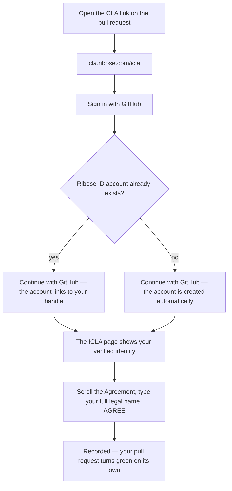

# How to sign the Ribose CLA

Every external contributor to a Ribose GitHub organization signs the
Individual Contributor License Agreement (ICLA) once. One signature
covers your contributions to all Ribose organizations on GitHub. This
document describes the signing flow; the enforcement App tells you on
a pull request when a signature is needed and links here.

You do not sign if Ribose already holds an agreement with you — staff
and contractors are covered by that agreement, the CLA process does not
apply, and the App and the portal never ask you for a signature. If you
are in doubt, the App's statement on your pull request says which case
applies to you.

## The signing flow

You sign in with your GitHub account. The Ribose ID account — the
identity account that holds the association permanently — is handled
for you in the same pass:

- If you **already have a Ribose ID account**, the **Continue with
  GitHub** step links it to your GitHub handle.
- If you **have never had a Ribose ID account**, the same
  **Continue with GitHub** step **creates one automatically** from
  your GitHub identity. Your verified GitHub email becomes the
  account's verified email. There is no registration form and no
  password to set.

## Steps, start to finish

1. **Open the link.** On a pull request, the `ribose-cla` App posts a
   comment that names the committer who needs to sign and links to the
   signing page. Open that link in your own browser — the page signs
   whoever is signed in, so the contributor signs in their own session.
2. **Sign in with GitHub.** GitHub asks you to authorize the Ribose CLA
   App. This proves that the handle is yours.
3. **Continue with GitHub on id.ribose.com.** Ribose ID asks you to
   authorize the Ribose ID App. This step either links your existing
   Ribose ID account to your GitHub handle or creates the account for
   you automatically (see above).
4. **Review the Agreement.** The exact text of the current edition
   renders on the page, with its sha256. The page shows your GitHub
   handle and your verified email — the identity the signature binds.
5. **Scroll through the Agreement** and **type your full legal
   name**. The typed name is the signature; the form does not submit
   without it, and the page unlocks the signature line only after the
   end of the Agreement has been on screen.
6. **AGREE.** The signature records append-only, with the edition, the
   exact text hash, and the signing IP address. Your pull request's
   `cla/ribose` check turns green on its own evaluation.
7. **See your record any time** at [cla.ribose.com/agreements](https://cla.ribose.com/agreements) —
   the edition you signed, its hash, and the exact text in a viewer.

## Committing from another email address

GitHub links a commit to your account only when the commit's git author
email belongs to your account. If you commit from a machine configured
with another address, the check cannot tell who you are.

Two answers, in order of preference:

1. **Link the address to GitHub** (Settings → Emails), configure git to
   use it, and push again. Every commit then links automatically.
2. **Verify the address in the portal.** At
   [cla.ribose.com/agreements](https://cla.ribose.com/agreements), under
   **Commit emails**, add the address. A one-time link is mailed to it;
   opening that link in the same signed-in browser records the address.
   Commits carrying it then count as yours — covered by the agreement
   you already signed, with no second signature. An address is only
   recorded after you prove you receive its mail.

## If your pull request is still blocked

The check re-evaluates on the next push. If the check has not caught
up, a maintainer can press **Re-run** on the `cla/ribose` check.

## Organization contributors

If your company has an executed Organization CLA, your employer's
Point of Contact adds your GitHub handle to its Schedule A, which
covers you without an individual signature. You can also request
coverage yourself at [cla.ribose.com/organizations](https://cla.ribose.com/organizations).
